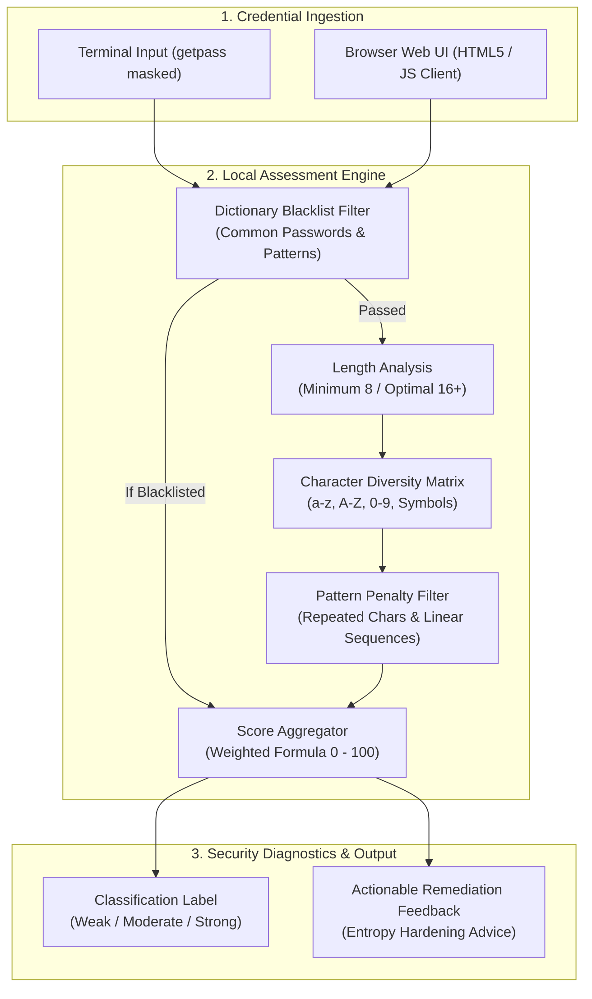

<div align="center">


[](https://thenudasahas2008.github.io/Password-Strength-Checker/)
[](https://github.com/thenudasahas2008/Password-Strength-Checker/actions/workflows/python-tests.yml)
[](https://python.org)
[](password_checker.py)
[](LICENSE)

<p align="center">
  <b>A zero-transmission cybersecurity utility providing client-side heuristic password auditing via a secure Python CLI terminal tool and a modern, responsive Web UI.</b>
</p>

[🌐 Live Demo](https://thenudasahas2008.github.io/Password-Strength-Checker/) • [✨ Key Features](#-key-features) • [🏗️ Architecture](#-heuristic-evaluation-architecture) • [🚀 Quick Start](#-quick-start-cli) • [🧪 Unit Testing](#-automated-testing) • [📁 Structure](#-repository-structure) • [🔒 Privacy Pledge](#-privacy--zero-transmission-pledge)

---

</div>

## 🌐 Live Web Demo

Experience the interactive, zero-transmission web application live in your browser:  
👉 **[Launch Live Password Strength Checker](https://thenudasahas2008.github.io/Password-Strength-Checker/)**

> [!NOTE]
> All password evaluation routines execute strictly within your local browser sandbox runtime memory. No input is ever logged, stored, or transmitted across the network.

---

## 📖 Overview

**Password-Strength-Checker** is an educational, privacy-first cybersecurity utility designed to assess credential resilience against brute-force, spray, and dictionary attacks. Built with both a standalone Python CLI tool and a responsive, cyber-themed Web frontend, it scores credentials from **0 to 100** and categorizes them into clear security tiers:

| Tier | Score Range | Resilience Posture | Primary Vulnerabilities |
| :--- | :---: | :--- | :--- |
| 🔴 **Weak** | `0 - 40` | Immediate breach risk | Trivial dictionary words, short length, predictable sequences (`12345`, `qwerty`). |
| 🟡 **Moderate** | `41 - 70` | Standard resilience | Basic complexity met, but vulnerable to GPU-accelerated hash cracking due to limited length. |
| 🟢 **Strong** | `71 - 100` | High security posture | High entropy, 16+ characters, balanced distribution of symbols, numerals, and mixed-case letters. |

---

## ✨ Key Features

- 🛡️ **Zero-Transmission Architecture:** Evaluates input strictly in local volatile memory. Zero packets, zero API calls, and zero telemetry dispatched.
- 🧮 **Multi-Factor Heuristic Engine:** Analyzes length thresholds, character diversity, uppercase/lowercase variety, numerals, and symbols.
- 🚫 **Dictionary Blacklist Defense:** Detects and flags top vulnerable passwords (`password`, `123456`, `admin`, `iloveyou`, `welcome`, etc.).
- 📉 **Pattern & Repetition Penalties:** Penalizes predictable repeated characters (`aaaaa`) and sequential runs (`abc`, `123`).
- 🕶️ **Masked Terminal Input:** Utilizes Python's native `getpass` module to obscure keystrokes from shoulder-surfing during CLI evaluations.
- 🧪 **Automated CI/CD Test Suite:** Complete `unittest` coverage across Python 3.9, 3.10, 3.11, and 3.12 via GitHub Actions.
- 📦 **Zero External Dependencies:** Built entirely with Python's standard library (`re`, `string`, `getpass`, `unittest`).

---

## 🧮 Theoretical Entropy Model

Password resilience can also be measured through theoretical information entropy:

$$\mathcal{H} = L \cdot \log_2(R)$$

where:
- $\mathcal{H}$ represents total bits of entropy.
- $L$ represents total password character length.
- $R$ represents the character pool pool size (e.g., 26 for lowercase, 52 for mixed case, 94 for full ASCII).

---

## 🏗️ Heuristic Evaluation Architecture



---

## 🚀 Quick Start (CLI)

### 1. Prerequisites
- **Python 3.9+** installed ([Download Python](https://www.python.org/downloads/))
- **Git**

### 2. Clone Repository
```bash
git clone https://github.com/thenudasahas2008/Password-Strength-Checker.git
cd Password-Strength-Checker
```

### 3. Run the CLI Tool
```bash
python password_checker.py
```
*(On macOS / Linux distributions, execute `python3 password_checker.py`).*

### 4. Interactive Terminal Session Example
```text
============================================================
           🔒 LOCAL PASSWORD STRENGTH CHECKER
============================================================
[INFO] Your credential is evaluated strictly in local memory.
[INFO] Zero data is saved, logged, or transmitted.

Enter a password to assess: ••••••••••••••••

------------------------------------------------------------
DIAGNOSTIC SUMMARY:
------------------------------------------------------------
Overall Score : 92 / 100
Classification: Strong [SECURE]
Entropy Checks:
  ✔ Length (16 characters)
  ✔ Mixed Case Letters (Uppercase & Lowercase)
  ✔ Numerical Characters
  ✔ Special Symbols & Punctuation
  ✔ No predictable dictionary patterns found
------------------------------------------------------------
```

---

## 🧪 Automated Testing

The project includes an automated test suite verifying edge cases, empty strings, blacklisted phrases, and boundary values.

Run the test suite directly with detailed verbosity:
```bash
python -m unittest -v test_password_checker.py
```

Or run automatic discovery across all test modules:
```bash
python -m unittest discover -s . -p "test_*.py" -v
```

### CI / CD Pipeline
Every push and pull request automatically triggers the GitHub Actions workflow [.github/workflows/python-tests.yml](.github/workflows/python-tests.yml) across Python 3.9 through 3.12.

---

## 📁 Repository Structure

```text
Password-Strength-Checker/
├── .github/
│   └── workflows/
│       └── python-tests.yml    # Automated CI matrix test runner
├── .gitattributes              # Language detection overrides (Python)
├── .gitignore                  # Python bytecode & temporary exclusions
├── index.html                  # Cyber-themed client-side Web Application
├── LICENSE                     # MIT Open Source License
├── password_checker.py         # Core Python CLI heuristic assessor
├── README.md                   # Comprehensive project documentation
└── test_password_checker.py    # Automated unittest suite
```

---

## 🔒 Privacy & Zero-Transmission Pledge

> [!IMPORTANT]
> - **Zero Transmission:** Neither the Python CLI script nor the web frontend transmits input to any remote server or external API.
> - **Safe Testing Practice:** Always use simulated or test passwords when evaluating security tools. Never enter real master passwords or production credentials into public software.
> - **Educational Heuristics:** This tool provides educational heuristic feedback. For enterprise-grade protection, pair complex passwords with multi-factor authentication (MFA) and dedicated password managers.
