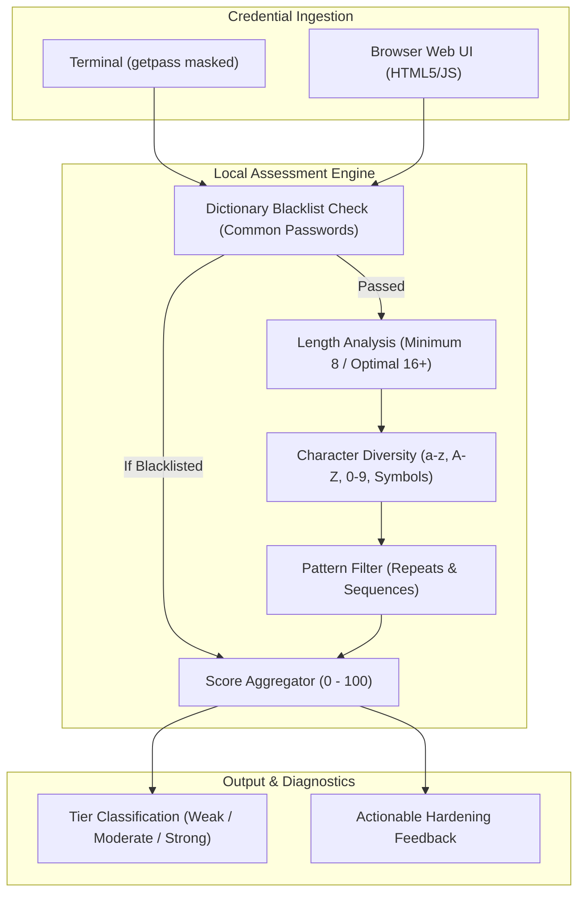

<div align="center">


[](https://thenudasahas2008.github.io/Password-Strength-Checker/)
[](https://github.com/thenudasahas2008/Password-Strength-Checker/actions/workflows/python-tests.yml)
[](https://python.org)
[](password_checker.py)
[](LICENSE)

<p align="center">
  <b>An educational cybersecurity tool providing zero-transmission, heuristic password auditing via a secure Python CLI terminal tool and a modern client-side Web UI.</b>
</p>

[Live Web Demo](https://thenudasahas2008.github.io/Password-Strength-Checker/) • [Key Features](#-key-features) • [Algorithm & Architecture](#-heuristic-evaluation-architecture) • [CLI Quick Start](#-quick-start-cli) • [Unit Testing](#-automated-testing) • [Security & Privacy](#-privacy--zero-transmission-pledge)

---

</div>

## 🌐 Live Web Demo

Try the interactive client-side web application directly in your browser:  
👉 **[Launch Password Strength Checker](https://thenudasahas2008.github.io/Password-Strength-Checker/)**

*(All calculations run entirely in your local browser sandbox; no passwords are ever logged, stored, or transmitted over the internet).*

---

## 📖 Overview

**Password-Strength-Checker** is a privacy-first cybersecurity utility designed to assess credential resilience against brute-force and dictionary attacks. Built with both a standalone Python CLI tool and a responsive cyber-themed web frontend, it scores credentials from **0 to 100** and categorizes them into clear tier labels:

- 🔴 **Weak (0 - 40):** High vulnerability to automated dictionary and pattern spray attacks.
- 🟡 **Moderate (41 - 70):** Basic complexity met, but lacks entropy or length depth.
- 🟢 **Strong (71 - 100):** Superior character variety, high entropy, and robust resistance to brute-force triages.

---

## ✨ Key Features

- 🛡️ **Zero-Transmission Architecture:** 100% local execution. Evaluates input directly in runtime memory with zero network packets sent or saved.
- 🧮 **Multi-Factor Heuristic Engine:** Analyzes password length, uppercase/lowercase variety, numeric distribution, and special characters.
- 🚫 **Dictionary Blacklist Defense:** Detects and flags common vulnerable passwords (`password`, `123456`, `qwerty`, `admin`, etc.).
- 📉 **Repetition & Sequence Penalties:** Identifies predictable patterns such as repeated characters (`aaaaa`) and linear sequences (`abc123`).
- 🕶️ **Masked Terminal Input:** Utilizes Python's native `getpass` module to hide keystrokes from shoulder-surfing in the terminal.
- 🧪 **Comprehensive Unit Test Suite:** Automated testing with Python's built-in `unittest` verifying edge cases, boundary values, and regression tests.
- 📦 **Zero External Dependencies:** Runs out of the box using only Python's standard library (`re`, `string`, `getpass`, `unittest`).

---

## 🏗️ Heuristic Evaluation Architecture



---

## 🚀 Quick Start (CLI)

### 1. Prerequisites
- **Python 3.9** or newer installed ([python.org](https://www.python.org/downloads/))
- **Git**

### 2. Clone Repository
```bash
git clone https://github.com/thenudasahas2008/Password-Strength-Checker.git
cd Password-Strength-Checker
```

### 3. Run the CLI Checker
```bash
python password_checker.py
```
*(On macOS / Linux systems, use `python3 password_checker.py`).*

### 4. Interactive Terminal Output Example
```text
============================================================
           🔐 LOCAL PASSWORD STRENGTH CHECKER
============================================================
[INFO] Your credential is evaluated strictly in local memory.
[INFO] Zero data is saved, logged, or transmitted.

Enter a password to assess: ••••••••••••••••

------------------------------------------------------------
DIAGNOSTIC SUMMARY:
------------------------------------------------------------
Overall Score : 90 / 100
Classification: Strong [SECURE]
Entropy Checks:
  ✔ Length (16 characters)
  ✔ Mixed Case Letters (Uppercase & Lowercase)
  ✔ Numerical Characters
  ✔ Special Symbols & Punctuation
  ✔ No predictable dictionary patterns found
------------------------------------------------------------
```

---

## 🧪 Automated Testing

The project includes unit tests covering edge cases, empty strings, invalid inputs, blacklisted credentials, and maximum entropy configurations.

Run all tests with detailed verbosity:
```bash
python -m unittest -v test_password_checker.py
```

### CI / CD Pipeline
Every push and pull request automatically triggers the GitHub Actions workflow [python-tests.yml](.github/workflows/python-tests.yml) across Python 3.9, 3.10, 3.11, and 3.12 matrices.

---

## 📁 Repository Structure

```text
Password-Strength-Checker/
├── .github/
│   └── workflows/
│       └── python-tests.yml   # GitHub Actions automated test workflow
├── .gitignore                 # Python bytecode & cache exclusions
├── index.html                 # Cyber-themed client-side Web Application
├── LICENSE                    # MIT Open Source License
├── password_checker.py        # Core Python CLI heuristic assessor
├── README.md                  # Project documentation & usage guide
└── test_password_checker.py   # Unit test test suite (unittest)
```

---

## 🔒 Privacy & Zero-Transmission Pledge

> [!IMPORTANT]
> - **Zero Transmission:** Neither the Python CLI tool nor the web page transmits input to any remote server or third-party API.
> - **Safe Testing:** Always use simulated or fictional passwords when demonstrating this tool. Never enter real master passwords or production credentials into public demonstration software.
> - **Educational Heuristic:** This tool provides educational heuristics. For enterprise security audits, combine with password managers, hardware tokens (FIDO2 / YubiKey), and multi-factor authentication (MFA).

---

## 👨‍💻 Author & Maintainer

<div align="center">

**Thenuda Sahas Sooriyaarachchi**  
*Cybersecurity Researcher • DFIR Analyst • Ethical Developer*

[](mailto:sahas.thenu@gmail.com)
[](https://github.com/thenudasahas2008)
[](https://thenudasahas.site/)
[](https://discord.com)

<p align="center">
  <sub>⭐ If this security tool helped your understanding, feel free to star the repo! ⭐</sub>
</p>

</div>
